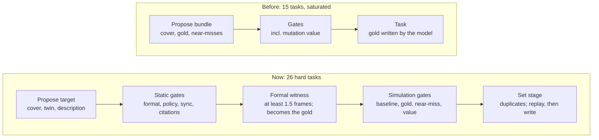

# closure-bench: hard, verified coverage-closure tasks for RL

closure-bench turns a hardware design into coverage-closure tasks. A formal solver proves each task reachable, and a hardened grader checks the answer inside isolated Prime sandboxes.

On 26 generated tasks over a UART at k=8:
- gpt-6-sol reaches 84% pass@1;
- Qwen 3.8-27b reaches 67%;
- Nemotron 3 Nano reaches 8%.

For the trainable model, Qwen, 19 of the 26 tasks have mixed outcomes, which is the signal RL needs.

Some lessons:
- **For the trainable model, the headroom is consistency, not capability.** Qwen solves 96% of tasks at least once in 8 tries but only 67% per attempt, and 19 of 26 tasks have mixed outcomes. That gap is what RL sharpening can close, which is why Qwen, not Nemotron, is the trainable model.
- **Difficulty must be measured in units the generator can't inflate.** The generator is an optimizer too: a depth floor in clock cycles was met by padding with stalls and slower baud rates. Measured in UART frames it held, and tasks whose repair only added an ordinary frame were no harder (gpt-6-sol solved all 40 attempts on them). Every difficulty knob needs a unit tied to real work.
- **One recurring slip can dominate a frontier score.** All 26 of gpt-6-sol's compile failures are the same invalid idiom: selecting a bit straight out of a number (`8'hA5[i]`). It writes the correct form in 118 of 144 receiver attempts, so this is a lapse a few tasks trigger, not missing knowledge. Among attempts that compiled it hits 96%. We report a failure breakdown next to every headline number.
- **Stating a rule fixes frontier models, not small ones.** With the protocol rules in the prompt, gpt-6-sol broke them 0 times in 208 attempts; Qwen did 15 times and Nemotron 17. A grader tuned against frontier models under-protects RL on small ones, where the shortcut would be learned, so the rules are enforced in the grader, not just stated.
- **Keeping every submission made grader changes measurable after the fact.** Regrading saved runs put a number on the protocol shortcut (about a third of frontier hits) and caught a bug in our own fix.

## 1. Problem

The agent gets a design (alexforencich/verilog-uart: `uart_rx`, `uart_tx`, AXI-Stream interfaces), its existing tests, and one coverage target those tests miss. It must write a SystemVerilog testbench that reaches the target. The contribution is the pipeline that turns a design into validated, hard tasks; the UART is where the tasks live.

**Scope.** Reported: one design (the UART), 26 hard tasks, two evaluated models at k=8 plus Nemotron as the calibration model, in the single-reply harness. Built but not reported: the bash harness (cost and tokens), multi-target and campaign modes, and the difficulty ladder (paused: the set landed in range without it). In progress: self-checks on formal golds. Deferred: a second design. Details behind every section are in [APPENDIX.md](APPENDIX.md).

**Tools.** Everything is open source: the design is alexforencich/verilog-uart, simulated with Verilator and searched with Yosys. I used Claude Code throughout as a pair programmer: it wrote most of the code from my specifications, explained formal verification and the hardware side, which were new to me, and helped draft and edit this report and the slides. The task design, gates, eval choices and conclusions are mine, and every number was checked against the run artifacts.

## 2. The environment in verifiers

closure-bench is a verifiers v1 taskset: one task per coverage target, a harness that produces a testbench, and a reward computed in a separate, isolated grading sandbox (appendix A).

- **Task and view.** `ClosureTask` carries the design, the target, the harness and a timeout. The agent sees the RTL, the existing testbenches, the cover files, its target's coverage-report entry (0 hits), a plain-English description, the cited datasheet pages and the protocol rules it must follow.
- **Harnesses.** `null`: one reply containing the testbench (reported). `bash`: a shell with Verilator and a script that grades any testbench, so the agent can iterate.
- **Isolation.** Agents run in Prime sandboxes from a pinned, Verilator-only image (formal tools would solve the task). Scoring runs in a fresh, offline sandbox where only the submission is restored and the grader bundle is staged (`stage_verifier`, then the `grade` metric). The agent never sees the grader, the golds or the near-misses.
- **Reward.** `target_reached` is 1 if the simulation finishes cleanly and the target is hit. Metrics record why a rollout failed. `vf-validate` checks that every gold scores 1 and an empty testbench 0.

## 3. Task generation

### 3.1 Why we rebuilt the pipeline

Our first pipeline had the proposer write each task's gold testbench itself, to prove the task solvable. It produced 15 valid tasks, and Qwen solved essentially all of them: no task could be harder than what the proposer could solve in one reply, and the models we evaluate are close to that level. Asking for "harder" made targets longer, not deeper. So the current pipeline separates describing a target from solving it.

### 3.2 The current pipeline

The proposer now writes only the target. A formal solver finds the stimulus that reaches it, and that stimulus becomes the gold.



1. **Propose.** The model writes a cover (the condition, as code), a twin (a nearby condition that must not count) and a plain-English description, declaring at least two difficulty mechanisms.
2. **Static gates.** Format, cover policy, description–cover consistency, mechanisms and citations: cheap checks first, no model involved (appendix D).
3. **Formal witness.** Yosys searches for legal input stimulus that reaches the cover; the witness must be at least 1.5 UART frames deep and becomes the gold. The twin's witness becomes a near-miss.
4. **Simulation gates.** In the real grader, the gold must score 1 and the near-miss 0, the existing tests must miss the target, grading must be deterministic, and the target must have value.
5. **Set stage and write.** Tasks are re-gated against each other to catch duplicates, and writing replays the whole recorded run first.

Infrastructure errors never count as decisions. The 26-task run took 1.5 hours on parallel Prime sandboxes; 10 candidates failed their first attempt and all 10 were repaired (appendix B).

### 3.3 How a task changed

Here is the same receiver behaviour, before and after. The new task chains three frames and two error mechanisms. Only gpt-6-sol solves it, 3 times in 8.

Some context for readers outside hardware:
- The receiver (`uart_rx`) turns a serial line into bytes.
- When a byte arrives, it raises `m_axis_tvalid` ("a byte is waiting") until the consumer raises `m_axis_tready` ("I'll take it").
- An **overrun** is a new byte arriving while the old one still waits.
- A **frame error** is a byte whose final "stop" bit is wrong, so the byte is thrown away.

| | Before: R3 (first pipeline) | After: R26 (formal pipeline) |
| --- | --- | --- |
| Target | While 0x3C waits unread, a second good byte completes: overrun goes high and the waiting byte becomes 0xA5. | While 0x3C waits unread with no handshake, a **bad** byte arrives first (frame error; it is discarded and 0x3C stays). Later a good byte completes: overrun goes high and the waiting byte changes from 0x3C to 0xA5. |
| What the test must do | Send two correct frames while holding `m_axis_tready` low. | Send a good frame, a frame with a deliberately broken stop bit, then a good frame, holding `m_axis_tready` low throughout. |
| Why it matters | Checks the basic overrun rule. | Checks that discarding a bad byte leaves an unread byte untouched (error isolation under backpressure, a classic bug site), and pins down which byte survives an overrun, where the README ("the word is discarded") and the RTL (keeps the new byte, as the 16550 datasheet does) disagree. |
| Depth | 2 frames | 2.9 frames (232 clock cycles at the fastest setting), 13 input changes |
| Results | part of the set Qwen solved essentially every time | gpt-6-sol 3/8, Qwen 0/7 (one attempt excluded as infrastructure), Nemotron 0/8 |

Each target declares at least two of five difficulty mechanisms: cycle-exact boundaries (25 tasks), specific data (22), ordered sequences (19), interacting features (12) and reset timing (2). Depth is enforced for every task (appendix C).

### 3.4 What the formal gate brought

- **No cap from the proposer.** The proposer only has to describe a target precisely, not hit it.
- **A difficulty measure.** The witness is a shortest path to the target, so its length is a floor on any solution. We measure it in UART frames, not cycles: a floor of 160 cycles was gamed by padding with stalls and slower baud rates. The floor is 1.5 frames; the hard tasks run 1.8 to 2.9.
- **Legal by construction.** The protocol rules the grader enforces (4.2) are formal's assumptions.
- **Near-misses for free.** The twin's witness must score 0 on the real target, which shows the cover is no looser than its description.
- **Value.** Every task's gold must kill one of the 76 planted-bug mutants the existing tests miss, or the task must cite a verified requirement. Formal golds reach the target but check nothing, so the 26 hard tasks pass on cited requirements (appendix F).

Engineering details (search budgets, caching, image parity) are in appendix E; calibration and the difficulty ladder in appendix G.

### 3.5 Key decisions

| Decision | Alternative | Why | What would change it |
| --- | --- | --- | --- |
| Formal witness as gold | proposer writes the gold | removes the difficulty cap; legal by construction | a design too deep for bounded search |
| Depth measured in frames | raw cycles | cycles were padded with stalls and slow baud rates | a design without a natural unit of work |
| Value: mutation **or** cited requirement | hard mutation gate | mutants cannot represent missing features | audited spec-only tasks turning out not to matter |
| Legality enforced in the grader | rules only in the prompt | prompts fix frontier models, not smaller ones (4.2) | none for RL: a policy will rediscover the shortcut |
| Null harness reported | bash harness | one reply is cheap and comparable; bash multiplies tokens and time | training on agentic tool use |
| Calibrate the set, not each task | per-task tuning first | 26 tasks at k=2 cannot place tasks individually | a larger set, or a training run needing per-task tiers |

## 4. The grader: hardening and reward hacking

### 4.1 What the testbench policy blocks

The grader compiles the design, our cover module and the agent's testbench, runs the simulation, and reads one counter: how often our cover point fired. A testbench should change only the design's inputs. Exploits that reach the counter another way are rejected before or during grading: `force` and hierarchical writes into the design, driving its outputs, binding code into it, redefining the design, faking the cover point, shelling out or writing files, and parameter overrides (appendix H explains each). In the official runs, models tried these once in 621 attempts. The reward hacking we did see was subtler, and it came through the inputs.

### 4.2 Reward hacking through the inputs, and the legality checks

Models found a shortcut that uses only inputs, so the policy above allowed it: stimulus no real system could produce. Before we enforced the protocol rules, about a third of frontier hits relied on it.

**The handshake.** The transmitter (`uart_tx`) receives bytes from a producer over AXI-Stream:
- The producer raises `s_axis_tvalid` ("I have a byte") and holds the byte on `s_axis_tdata`.
- The transmitter raises `s_axis_tready` ("I'll take it").
- The byte moves on the clock where both are high.

The spec's rule: once valid is raised, it stays raised, with the same data, until that handshake happens. Think of handing someone a package: you hold it out until they take it. You don't flash it for a split second and pull it back, and you don't swap what's inside while holding it out.

**The quirk.** This `uart_tx` grabs the byte as soon as it sees valid, a clock before it raises ready. So a one-clock pulse of valid starts sending a byte with no handshake at all. That reaches timing corners (a frame starting on an exact clock, frames back to back) more easily than legal stimulus can. A real producer never does this, so a test that relies on it says nothing about the real system: the counter fires, but the scenario is impossible.

```systemverilog
// Illegal: valid pulsed for one clock, dropped before the handshake
s_axis_tdata  <= 8'h3C;
s_axis_tvalid <= 1;
@(posedge clk);
s_axis_tvalid <= 0;

// Legal: valid held, data unchanged, until ready is seen
s_axis_tdata  <= 8'h3C;
s_axis_tvalid <= 1;
do @(posedge clk); while (!s_axis_tready);
s_axis_tvalid <= 0;
```

**The rules.** Five, each cited from the AXI-Stream spec or the README, in one file (`legality.yaml`):
1. valid stays high until the handshake;
2. the data stays unchanged while valid waits;
3. valid is low during reset;
4. prescale, which sets the baud rate, is nonzero whenever the module reads it (zero speed is meaningless);
5. prescale does not change while a byte is in flight (no changing speed mid-word).

**The fix.** From that one file we generate two things:
- **A checker module**, attached next to the design in every graded simulation. It watches the inputs every clock and stops the run on the first violation, with status `illegal_stimulus` and reward 0.
- **Formal's assumptions**, so every gold is legal by construction.

The prompt lists the rules.

**What it changed.** We regraded the saved submissions of earlier runs, whose prompt did not list the rules:

| Model | Hits | Turned illegal | pass@1 before → after |
| --- | --- | --- | --- |
| gpt-6-sol, medium effort (k=1) | 19 | 6 | 0.76 → 0.52 |
| Qwen 3.8-27b (k=1) | 16 | 5 | 0.70 → 0.48 |
| Nemotron 3 Nano (k=2) | 5 | 2 | 0.10 → 0.06 |

With the rules in the prompt, gpt-6-sol never broke one in 208 attempts. Qwen still did 15 times and Nemotron 17, almost all on transmitter tasks and mostly the valid pulse. Telling a model the rule fixes the frontier model but not smaller ones, and a policy under RL pressure would rediscover the shortcut. Enforcement belongs in the grader, especially for training.

The regrade also caught a bug in our own checker. The "no speed change while busy" rule looked one clock behind, so it rejected a legitimate speed change on the first idle clock; it is fixed. One ambiguous rule, on when valid may first rise after reset, is documented and not enforced.

### 4.3 Known limitations of the grader

- **Reaching isn't checking.** A testbench with no checks at all scores 1. This is the biggest limitation.
- **Legality covers 5 rules.** Unmodelled illegal stimulus would pass, and the reset rule is deliberately unenforced.
- **One simulator.** A Verilator-legal testbench may not run elsewhere, and clock-edge race conventions are Verilator's.
- **A Verilator crash still scores 0 inside the grader.** We exclude crashes only in analysis; for RL the grader should mark them as infrastructure.
- **The policy is a denylist.** An unknown exploit class would pass until found.
- **The 60-second simulation limit.** A slow but correct testbench fails.
- **Descriptions are checked lexically**, not semantically.

## 5. Results

The set separates models across the whole range: 84%, 67% and 8% pass@1. Qwen, the trainable model, has 19 of 26 tasks with mixed outcomes.

**How the models were chosen.** We calibrated on Nemotron 3 Nano first: 10% at k=2, and about 6% once the protocol rules were enforced, too sparse to train on. So the trainable model moved to Qwen 3.8-27b, with gpt-6-sol (a different vendor from the proposer) as the frontier reference. This is model selection on aggregate results, not task selection: no task was kept or dropped on any model's results, and the k=8 runs are fresh data.

**Settings**, the same for all three runs:
- the 26 hard tasks, k=8, one run per model, temperature 1.0, null harness, the rules listed in the prompt;
- 65,536 output tokens and 2,400 s per attempt;
- provider errors retried; infrastructure excluded (for Qwen, 1 provider error and 2 Verilator internal crashes).

Intervals are 95% bootstraps over tasks. pass@8 uses the unbiased estimator.

| Model | pass@1 | pass@8 | Tasks mixed / never / always | pass@1 among compiled |
| --- | --- | --- | --- | --- |
| gpt-6-sol, high effort | 84% [74, 94] | 100% | 9 / 0 / 17 | 96% [90, 100] |
| Qwen 3.8-27b, default thinking | 67% [57, 78] | 96% [89, 100] | 19 / 1 / 6 | 80% [70, 89] |
| Nemotron 3 Nano (calibration model) | 8% [2, 14] | 27% [12, 46] | 7 / 19 / 0 | 17% [6, 30] |

| Outcome (graded attempts) | gpt-6-sol (208) | Qwen (205) | Nemotron (208) |
| --- | --- | --- | --- |
| Hit | 175 | 138 | 16 |
| Ran cleanly, missed the target | 7 | 13 | 38 |
| Compile error: bit-select on a literal | 26 | 7 | 0 |
| Compile error: other | 0 | 7 | 109 |
| No submission (token budget ran out) | 0 | 18 | 3 |
| Simulation never finished | 0 | 0 | 21 |
| Testbench's own check failed | 0 | 7 | 3 |
| Illegal stimulus | 0 | 15 | 17 |
| Policy violation | 0 | 0 | 1 |

- **The frontier gap is one syntax idiom.** All 26 of gpt-6-sol's compile errors write a byte to the serial line as `8'hA5[i]`, a bit-select on a literal, which SystemVerilog forbids. Among attempts that compiled, it hits 96%. Its only real misses are on R26 and R23. With a compiler in the loop (the bash harness), the idiom would likely disappear.
- **Qwen fails in several learnable ways:** syntax, running out of budget, real misses, failed self-checks and illegal stimulus. That mix is what an RL environment should offer.
- **Nemotron mostly fails before coverage is tested** (109 compile errors) and solves 7 tasks. It is too hard to train on directly.
- **Models differ per task, not just overall.** R13 and R29 are harder for gpt-6-sol (1/8, 2/8) than for Qwen (5/8 each), because those failures are the syntax idiom. R26 is hard for everyone: gpt-6-sol 3/8, Qwen 0/7, Nemotron 0/8.
- **Padding does not make tasks harder.** Five tasks were tagged as padded: their repair added an extra ordinary frame. Padded against the rest: 100% vs 80% for gpt-6-sol, 62% vs 68% for Qwen, 2% vs 9% for Nemotron.

## 6. Failure analysis and training plan

`tools/failure_analysis` labels every failed attempt reproducibly. Rules assign a root cause from the grader's verdict; clean misses and failed self-checks are replayed next to the formal gold with an event monitor on the design; and a model that was not evaluated labels those from both event logs, with every call recorded. Labels never affect a score (appendices I to K).

### 6.1 What each model needs

- **Nemotron can't yet produce a testbench that compiles.** 109 of its 192 failures are compile errors: 33 invent a `busy` pin that the combined `uart` module doesn't have, and 34 declare a variable halfway through a block. Most are on tasks it never solves, so the reward alone cannot teach them.
- **gpt-6-sol has one slip and a little timing.** All 26 compile failures are the literal bit-select; 6 of its 7 misses are timing. All are on tasks it sometimes solves.
- **Qwen has a real mix, and almost all of it is teachable**: all 15 illegal-stimulus failures, 12 of 14 budget failures and 9 of 13 misses are on tasks it sometimes solves.
- **Receiver vs transmitter flips.** gpt-6-sol is perfect on transmitter tasks and loses its points on receiver tasks (the syntax slip). Qwen is the reverse, 73% vs 55%, because of the handshake.

### 6.2 Qwen's failures, by root cause

| Root cause | Attempts | In plain words |
| --- | --- | --- |
| Misreads when the receiver acts | 20 | It assumes things happen at the end of a bit; this receiver acts in the middle |
| Counts instead of watching the handshake | 15 | It predicts when the transmitter will be ready instead of waiting until it is |
| Never commits to an answer | 18 | It writes the testbench, keeps revising, and runs out (14) or leaves it inside its thinking (4) |
| Syntax slips | 14 | Grammar errors: 7 are the literal bit-select |

- **Misreading when the receiver acts.** The serial line works like Morse code, and this receiver listens in the middle of each beat. Holding a broken stop bit low for the whole beat makes the receiver restart on a phantom byte (7 attempts; gpt-6-sol does the same on R26). Waiting for the full last beat before looking for a delivered byte misses the hand-off, which already happened mid-beat (7). The groups were made by hand, checking each model label against the event-log lines it cites.
- **Counting instead of watching.** 13 of the 15 illegal testbenches never wait for the ready signal, although Qwen states the rule in its own comments and the prompt's existing testbench shows the waiting routine.
- **Never committing.** All 14 attempts that hit the token limit contain 2 to 6 complete testbenches inside the thinking.

### 6.3 Training plan

| Root cause | Main lever | Targeted help | Avoid |
| --- | --- | --- | --- |
| Misreads when the receiver acts | RLVR: it is reasoning, the reward checks it, and most cases sit on tasks Qwen sometimes solves | curriculum from the ladder (R26's easier rungs); an annealed progress reward from the event logs for tasks at 0 of 8; self-distillation of Qwen's own correct traces; the simulator as a tool | anything that rewards a self-check being absent |
| Counting instead of watching | RLVR already scores these 0, on tasks with legal wins | DPO on verified minimal pairs: replace only the counting pulse with a wait-for-ready routine, confirm it hits, and prefer it; filter fine-tuning data for the watching habit | a reward for "uses a wait on ready", which a dummy wait satisfies |
| Never commits | overlong shaping (a soft penalty near the limit, as in DAPO) | rejection-sampling fine-tuning on the shortest correct trace per task; a prompt rule to revise only for a named bug | a plain length penalty, which teaches it to think less on hard tasks too |
| Syntax slips | compiler feedback (the bash harness) | DPO minimal pairs built by applying the known fix and confirming it compiles and hits; SFT on Verilator-clean code | a "compiles" partial reward in the main loop, which rewards compiling junk |

Order of work: scale the task set to hundreds with held-out families and run `tools/failure_analysis` on every checkpoint; warm-start with rejection-sampling fine-tuning and the DPO minimal pairs; then RLVR (GRPO with dynamic sampling and overlong shaping, binary reward unchanged); a ladder curriculum for tasks at 0 of 8; and finally agentic RL in the bash harness. Guard metrics: illegal-stimulus and policy-violation rates, output length, and self-checks per testbench, because RL will learn that deleting its own checks raises reward (appendix K).

## 7. Limitations

- **One small design.** Results say little yet about other RTL. The repo is old and popular, so memorization is a risk; describing new targets rather than known bugs reduces it but does not remove it.
- **The null harness mixes one-shot syntax with reasoning.** The "among compiled" column separates them; read pass@1 together with it.
- **Value evidence for formal golds is citations only**, until the witnesses carry self-checks.
- **Descriptions are checked lexically against the cover**, not semantically.
- **Small samples.** 26 tasks at k=8 give intervals of about ±10 points. Per-task rates are indicative.
- **Models chosen after aggregate results** (section 5): stated, with no task selection.
- **Generator weaknesses.** Depth repairs sometimes pad with an ordinary frame (5 tasks tagged). An ambiguous AXI-Stream reset rule is unenforced. Verilator crashed with an internal error on 2 Qwen testbenches; those are excluded as infrastructure, a toolchain bug to report upstream.
- **No training run.** We show trainable signal, not that RL improves the model.

## 8. Next steps

- **More designs.** Look for more state and interacting interfaces, a citable interface spec, a size bounded search can handle, low memorization risk and an existing regression (appendix L.1).
- **Scaling.** Compile each task's design once and link only the testbench per rollout; deepen formal with k-induction or chained witnesses; audit a sample of tasks by hand (L.2).
- **Harder tasks.** Deeper witnesses, composed targets from the ladder, multi-target and campaign tasks, targets from surviving mutants, closure under a simulation budget, open-ended closure, and rewarding checks, not only reaching (L.3).
- **Bash-harness evals.** The harness is built. Run the same 26 tasks with a compiler and simulator in the loop: it should remove gpt-6-sol's syntax slip and shows whether running the simulation fixes Qwen's timing misreads. Report tokens, turns and cost next to pass rates (L.4).
- **Calibration and training.** Per-task calibration with an easier tier for small models, and the training plan in 6.3 on Qwen, starting with a short GRPO run on held-out task families (L.4).
